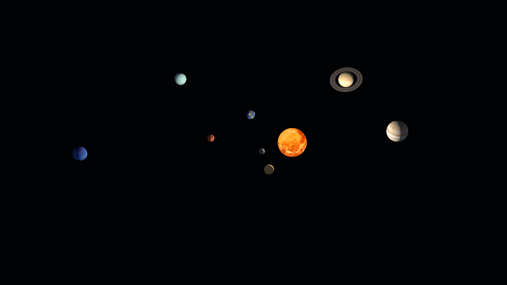

# Interactive 3D Solar System Visualization

CS 4361 Computer Graphics — Team 3. Unity 6000.6.8f1, C#, Built-In Render Pipeline.

Thai's Scene & Visuals portion includes a Sun and eight planets with
2K Solar System Scope textures, illustrative orbital spacing, Sun lighting,
textured Saturn rings and nine connected celestial prefabs. Active assets are
organized by type, and obsolete textures and generation code have been removed.
Shivansh's revolution, axial rotation and orbit paths are integrated into Main.
Pause and speed controls affect planetary motion only. Denny's information panel
and planet picker are integrated. Interactive camera navigation and click selection
remain assigned to Jose.

## Open and demonstrate

1. Install Unity Hub, Git and **Unity 6000.6.8f1** for your OS/CPU. All members
   must use the exact version in ProjectSettings/ProjectVersion.txt.
2. Clone the whole repository (including .meta files), or use your existing copy:

   ```bash
   git clone https://github.com/vinhthaitong/Interactive-3D-Solar-System-Visualization.git
   cd Interactive-3D-Solar-System-Visualization
   ```

3. Check out `feature/thai-scene-visuals` to run Thai's Scene & Visuals
   implementation. Teammates develop their features on their assigned branches.
4. In Unity Hub, add the folder containing Assets, Packages and ProjectSettings.
   Open with 6000.6.8f1, wait for import/compilation, and open
   **Assets → Scenes → Main** (`Main.unity`).
5. Press **Play**. Use a **16:9 Game view** for the supplied overview framing.
   Planets revolve and rotate. Use **Pause/Resume** and the **0.25x–5x speed slider**
   in the upper-left corner. Choose a planet from the bottom picker to show its
   facts; the X button clears the selection. Camera navigation is not yet integrated.
6. Inspect Sun illumination, each planet's surface, and Saturn's tilted rings.
   Select scene objects in the Hierarchy for close inspection in Scene view.
   This does not require an in-game selection implementation.
7. Stop Play before editing. Run **Solar System → Verify Thai Scene Visuals**
   to check the saved contracts; inspect the Console for errors.

The saved scene and generated assets are included: setup generation is not
required on each launch. No additional downloads or third-party packages are needed.

## Thai's implementation

| Body | Orbital radius | Diameter | Appearance |
| --- | ---: | ---: | --- |
| Sun | 0 | 6 | Unlit yellow/orange surface and central point light |
| Mercury | 7 | 1.2 | Dark gray rocky detail |
| Venus | 10 | 1.9 | Cream/gold cloud texture |
| Earth | 13.5 | 2 | Supplied day map with real continent shapes and emissive city lights |
| Mars | 17 | 1.5 | Red/orange rocky detail |
| Jupiter | 23 | 4.5 | Brown/cream bands and oval storm |
| Saturn | 30 | 3.8 | Pale gold bands, tilted two-part rings |
| Uranus | 37 | 2.9 | Light cyan bands |
| Neptune | 43 | 2.8 | Deep blue bands |

Sizes and distances are illustrative. The root positions lie in the XZ plane
around the Sun with different initial phases. Adjacent orbital shells have
clearance even at conjunction, including Saturn's outer ring radius of 4.104.
The eight planets use the supplied 2048×1024 spherical image maps. Venus uses
its cloudy atmosphere map as its visible exterior. Earth uses the
day map for color and the night map for emissive city lights. Standard's emission
is always present, so city lights are not explicitly masked by the day/night
terminator. The Sun uses its supplied 2048×1024 image with the existing self-lit
material and separate point light. Low ambient
illumination retains surface readability while the Sun lights from the center.
Saturn's supplied RGBA strip is mapped radially across both ring faces; alpha
cutout preserves its gaps without adding colliders or transparency sorting issues.



[Planet surface closeups](Screenshots/PlanetSurfaces.png) show Sun, Mercury,
Venus / Earth, Mars, Jupiter / Saturn, Uranus, Neptune in a 3×3 grid.
[Earth's night hemisphere](Screenshots/EarthNight.png) shows the city-light map.

## Texture credits

Sun, planet, Earth day/night and Saturn ring texture images are by
[Solar System Scope — Solar Textures](https://www.solarsystemscope.com/textures/),
distributed under the
[Creative Commons Attribution 4.0 International license (CC BY 4.0)](https://creativecommons.org/licenses/by/4.0/).

The eleven included 2K source images in `Assets/Textures/CelestialBodies/` were
copied unchanged from the supplied downloads. This project applies Unity import
settings, materials, spherical/radial UV mapping and Earth city-light emission;
the source image files themselves were not edited. Source and license checked
November 19, 2026.

## Project structure

The active project files are grouped by asset type:

```text
Assets/
  Materials/CelestialBodies/       # Nine body materials and Saturn rings
  Meshes/CelestialBodies/          # Saturn's reusable ring geometry
  Prefabs/CelestialBodies/         # Sun and eight planet prefabs
  Scenes/Main.unity               # Shared integrated scene
  Scripts/Core/                  # Shared contracts
  Scripts/SceneSetup/Editor/      # Three visual setup/verification tools
  Textures/CelestialBodies/       # Eleven active supplied image maps
Screenshots/                     # Rendered verification images linked here
```

CameraControls and Interaction remain reserved for Jose. Denny's UI scripts,
information prefab and data asset are under Scripts/UI, Prefabs/UI and Data.
This README is the shared setup and integration guide.

Important files:

- `Assets/Scenes/Main.unity`: saved scene with existing shared references and nine
  connected prefab instances.
- `Assets/Materials/CelestialBodies/`: nine body materials and SaturnRings.
- `Assets/Textures/CelestialBodies/`: eleven supplied maps used by those materials.
- `Assets/Meshes/CelestialBodies/SaturnRings.asset`: the reusable ring mesh.
- `Assets/Prefabs/CelestialBodies/`: Sun and eight planet prefabs.
- `Assets/Scripts/SceneSetup/Editor/SolarSystemVisualSetup.cs`: updates the existing
  scene, creates missing owned assets, connects prefabs and saves Main.
- `Assets/Scripts/SceneSetup/Editor/PlanetTextureMaps.cs`: configures 2K imports,
  updates existing material assets, sets Earth emission and radial ring UVs.
- `Assets/Scripts/SceneSetup/Editor/SceneVisualVerification.cs`: contract checks,
  batch repeatability/preservation checks, render capture and Play verification.

All visual setup code is Editor-only. The four shared Core components are unchanged.

## Applying visuals and preserving integration work

Open Main, stop Play, then use **Solar System → Apply Thai Scene Visuals**.
This is for initial setup or restoring missing owned assets, not a required Play step.

The command preserves existing body objects, colliders, CelestialBody IDs and
SolarSystemReferences. It recognizes the foundation's exact placeholder layout
before setting radii/sizes; later transforms are preserved. It frames only the
unchanged starter camera. Later camera controls remain Jose's work. A second
run preserves existing materials, textures, prefabs, added children/components,
body transforms, camera settings and Sun light edits. It never deletes scene
objects, resets Main, or applies new overrides to existing prefab assets.

Existing owned assets are reused, so editing a material in the Inspector is
supported. The eleven included image maps are the required texture sources;
unused procedural PNGs, their generator and the unused Venus surface alternative
have been removed. New prefabs are connected only when that prefab asset is
absent. Resolve pre-existing custom prefab connections with the owner rather
than replacing them.

The supplied maps are already assigned; no manual texture drag-and-drop is
needed. **Solar System → Apply Supplied Planet Maps** explicitly reapplies the
supplied textures and import settings to Thai's material and ring mesh assets.
This command preserves asset GUIDs and does not reposition or replace scene
objects. It deliberately resets those materials' appearance to the supplied maps;
ordinary Apply Thai Scene Visuals continues to preserve later material edits.
Use `PlanetTextureMaps.ApplyBatch` to apply and verify the maps in batch mode.
**Solar System → Apply Supplied Sun Map** reapplies just the Sun image without
changing planet materials, scene transforms or lighting. The Sun map is already
assigned; this command is not required to run the scene.

**Solar System → Create Starter Scene** is the older foundation command. It
refuses to overwrite Main. Do not delete Main to rerun foundation creation.

## Shared contracts and team responsibilities

| Member | Branch | Assigned features |
| --- | --- | --- |
| Thai Tong | feature/thai-scene-visuals | Sun/planets, layout, lighting, materials/textures, celestial prefabs, Main integration and visual compatibility |
| Denny Dat Tran | feature/denny-ui | Planet data, information panel, show/hide behavior and selection event subscription |
| Jose Beltran Gonzalez | feature/jose-camera-selection | First-person navigation, zoom, raycast planet selection and selection notification |
| Shivansh Vaidhyanathan | feature/shivansh-motion | Revolution, axial rotation, reusable movement components and visible orbit paths |

The team changed from five members to four after Zachary Sherrell dropped the
course; no tasks remain assigned to the former member.

- `PlanetId`: Mercury through Neptune in orbital order; excludes the Sun.
- `CelestialBody`: each planet's ID and BodyTransform. Planet colliders stay on
  the same root as this component, so raycast hits can identify the body directly.
- `SolarSystemReferences`: Sun Transform, eight CelestialBody references in ID
  order, main Camera and SelectionService. These remain on SolarSystem.
- `SelectionService`: CurrentSelection and SelectPlanet/SelectionChanged.
  Jose publishes changes; Denny listens, handles null and unsubscribes when disabled.
  UI should also read CurrentSelection on enable.

Shivansh can move each referenced root Transform around the Sun and rotate it.
Saturn's ring child and the Sun's light child follow their parent; rings have no
collider that could intercept a selection ray. Preserve component and asset GUIDs.
Do not rebuild the bodies or scene to integrate another member's system.

Thai owns Assets/Scripts/SceneSetup, Assets/Scenes, Assets/Materials,
Assets/Textures, Assets/Meshes and Assets/Prefabs/CelestialBodies. The existing
starter command is in Assets/Scripts/Editor. Other source folders remain reserved
for their owners.

## Testing

The automated checks cover names/IDs, body/reference counts, saved textures and
materials, shader support, colliders and raycasts, prefab contents/connections,
orbital clearance, ring geometry, lighting, camera framing, repeatability and
saved-scene reload. A graphics-enabled run can save the actual Main camera image
to `Screenshots/SceneOverview.png`. Play mode is a separate check.

Latest implementation verification, November 19, 2026: Unity compilation,
Editor contracts, supplied-map imports/materials, ring UVs/alpha cutout,
repeatability, preservation probes, saved-scene reload and Metal rendering passed.
The cleaned project also entered Play and passed its contract/render check on
the first observed frame. Runs used an isolated copy while the main Editor stayed
open; checkout assets matched the validated copy byte-for-byte.

The final inventory is eleven referenced images, ten materials, nine celestial
prefabs and one ring mesh. Cleanup preserved active GUIDs, left no missing asset
references or unused image/material/mesh assets, and produced renders identical
to those before reorganization. Surface closeups and Earth's night hemisphere
were inspected.

The older starter generator has a nonblocking deprecation warning. Sustained
interactive demonstration, Windows and integration with teammates' actual
features remain pending.

For repeatable command-line verification, close the interactive Editor and run
these arguments with your installed Unity executable from the repository root:

```text
-batchmode -quit -projectPath <repository-folder> -executeMethod SceneVisualVerification.RunBatch -logFile <log-file>
```

Use `SolarSystemVisualSetup.ApplyBatch` instead to apply visuals before checking.
`-nographics` supports structural checks but cannot verify appearance. For the
Play check, use `SceneVisualVerification.PlayModeBatch` and omit `-quit`; the
check exits with its result after checking the first observed Play frame. The
tests may temporarily simulate later edits and restore the exact saved Main file
in a finally block.

Manual team checks still include Windows with 6000.6.8f1, interactive Game-view
appearance at the demonstration resolution, and integration with teammates'
actual motion, camera, selection and UI. Do not infer those results from raycast
or reference checks alone.

## Git collaboration

Commit local work before switching or pulling. Create an assigned feature branch
once; use `git switch feature/your-branch-name` for an existing branch. Thai's
current session uses `feature/thai-scene-visuals`.

```bash
git fetch origin
# On your feature branch, after committing your work:
git merge origin/main
# Review only the intended changes and their .meta files before committing:
git status
git diff --check
git diff
```

Push the feature branch after committing, open a PR with main as the base and
request teammate review. Coordinate Main edits with Thai; teammates should use
their own test scenes. Do not force-push, discard others' work or rewrite shared
history. Ignore Library, Temp, Logs, UserSettings and builds. Keep Assets .meta
files, Packages and ProjectSettings tracked. All members use the same Editor
version and generate their own local Library.

The foundation was shared on main in November 2026.

## Motion integration

Main is the single demo and build scene. It uses PlanetOrbit, PlanetRotation, OrbitPath and
SimulationControls on the existing SolarSystem object. Shared Core contracts,
planet roots, colliders and prefab GUIDs are preserved. Speeds use the common accelerated clock described below.
All eight planets use rounded sidereal spin and orbital periods from the
[NASA Planetary Fact Sheet](https://nssdc.gsfc.nasa.gov/planetary/factsheet/).
Earth spins at 50 degrees/second: 23.9 real hours pass in 7.2 simulation seconds.
Spin speed is -50 * 23.9 / signedRotationHours; orbital speed is
50 * 23.9 / (orbitalDays * 24). Venus and Uranus spin retrograde.
The Sun uses the same clock with a 25-day equatorial period (about -1.99167
degrees/second), based on [NASA Sun facts](https://science.nasa.gov/sun/facts/).
Its position stays fixed; pause/speed controls affect all motion together.

At 1x, an Earth orbit takes about 44 minutes, so orbital movement is subtle.
The slider can accelerate it up to 5x. Sizes, distances, circular coplanar orbits
and axial orientations remain illustrative; these changes match periods and
spin directions, not full physical dynamics or differential solar rotation.
Saturn gets a runtime surface child; its root and tilted ring child do not spin.
Orbit lines follow the Sun position in LateUpdate. Pausing uses a local motion
multiplier rather than changing global Time.timeScale. Controls use Unity IMGUI
and require no Canvas, EventSystem or extra packages.

November 23 integration checks compiled successfully in Unity 6000.6.8f1.
Automated scene checks passed before consolidation, including shared references, eight
orbit paths, Saturn surface/collider setup, pause and Sun translation. A headless
Main Play check observed revolution, surface rotation, a stable Saturn root and
pause. The run also logged a Unity Editor Search indexing exception; no project
script exception was reported. Visual controls and slider interaction still need
an interactive Game-view check. The November 19 verification describes the earlier visuals.

The duplicate motion test scene was removed after confirming its contents matched
Main exactly. Open Main for visuals, planetary motion and pause/speed controls.

## Planet information UI

The saved Main scene includes Denny's screen-space information panel, eight-planet
picker and Input System UI EventSystem. The reusable prefab is
`Assets/Prefabs/UI/PlanetInformationUI.prefab`; editable facts are stored in
`Assets/Data/PlanetInfoDatabase.asset`. Each record includes the planet name,
type, diameter, mean distance from the Sun, orbital period and a short description.
Numeric values are rounded from the
[NASA Planetary Fact Sheet](https://nssdc.gsfc.nasa.gov/planetary/factsheet/).
The scene's illustrative positions and sizes are separate from these real values.

`PlanetInfoPanel` reads `SelectionService.CurrentSelection` when enabled, listens
to `SelectionChanged`, and unsubscribes when disabled. The bottom buttons publish
through `SelectPlanet`, so the information panel can be demonstrated before Jose's
camera raycast is ready. Jose's selector can use the same service without changing
the panel. The X button calls `SelectPlanet(null)` and returns to the prompt.
The panel currently displays no changing distance-from-Earth or moon count.

If the owned UI assets are missing, stop Play, open Main and choose
**Solar System → Apply Denny Planet Information UI**. Existing data and prefab
assets are reused, so editing a fact in the Inspector is preserved. An isolated
Unity 6000.6.8f1 batch run compiled the scripts, generated the prefab and scene,
and passed a Play check for button selection, external selection, fact display
and clearing selection. A separate Editor Search indexing exception appeared in
the batch log; no project-script exception was observed. Interactive Game-view
layout and integration with Jose's eventual camera controls still need review.
